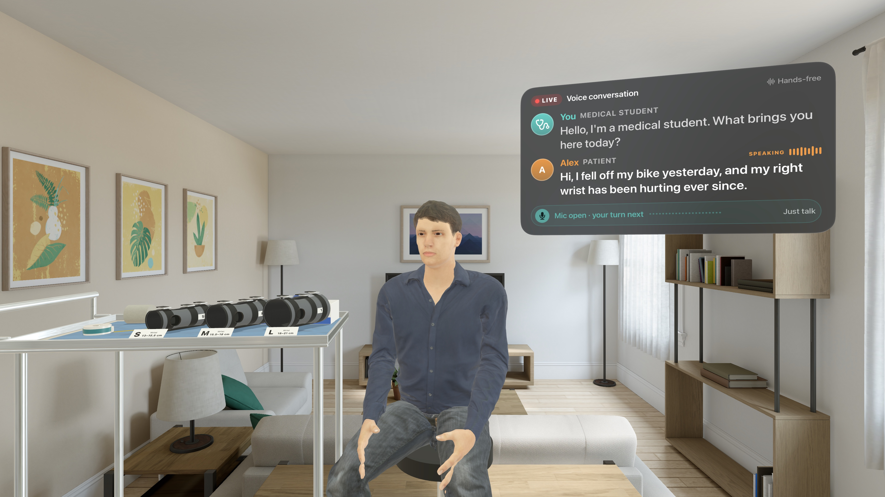

# MedSim XR

We’re Team Retina. We built MedSim XR at Healthcare Hackathon Bayern in Erlangen, Germany, on 12–14 November 2026. It’s an Apple Vision Pro prototype for practising patient interviews and physical exams.

## The hackathon

Medical Valley EMN organised the event. Teams had about 48 hours to work on a healthcare challenge before presenting their prototypes to a jury. [Event recap](https://www.medical-valley-emn.de/en/recap-healthcare-hackathon-bayern-erlangen-2026/)

We worked on OTH Amberg-Weiden’s **Meet Your AI Patient** challenge. The brief was to give medical students a way to practise taking a patient history with a virtual patient and get feedback afterwards. [Challenge brief](https://hackathon.medical-valley-emn.de/meet-your-ai-patient/)

We started with a wrist injury. You can ask how it happened, check where it hurts, and look at the X-ray before writing down your assessment. The AI handles the conversation. The case defines what you find on examination and how the session is scored, so you can repeat it and see how a different approach changes your result.

## What you can try

- **Wrist injury** · Examine a patient who fell from a bicycle, review imaging, and measure and fit a wrist support in the orthotics lab.
- **Obstetric ultrasound** · Apply gel, position the probe, and identify and measure views in a simulated mid-trimester scan.
- **Trauma journey** · Coordinate with simulated teammates as one patient moves from the roadside or forest trail through an ambulance to the emergency department.
- **MedSim Studio** · Configure a case, publish it with a launch code, trigger events with the Live Director, and review the debrief. Try `LKGLZX` (guided clinic), `5344E7` (busy walk-in), or `7B46EL` (forest trail) on a fresh Studio library.

The [demo script](docs/demo-script.md) walks through the wrist case. For the pitch, we mocked up how the simulation could adjust noise and distractions in response to the learner’s heart rate. That demo used staged readings. [Pitch deck](docs/pitch/MedSimXR-pitch.pptx) · [Screenshots](docs/screenshots/pitch/README.md)

## Run locally

### Clinical backend and Studio

The [backend setup](backend/README.md) covers Python 3.12+, macOS, Linux, and Windows. For a browser-only demo, build [MedSim Studio](studio/README.md) first and start the backend afterward. The backend serves the built Studio at <http://localhost:8000/app/> and its API docs at <http://localhost:8000/docs>.

### Vision Pro app

Use a Mac with Xcode 26 or later and the visionOS SDK. The app targets visionOS 26 or later. Open the checked-in [Xcode project](visionos/MedSimXR.xcodeproj), choose a simulator or a Vision Pro, and run. The [app setup](visionos/README.md) covers project generation and configuration. Follow the [device guide](docs/vision-pro-setup.md) for pairing, signing, and connecting over your local network.

The app bundles case logic and scripted audio for offline sessions. For live conversation, follow the [ElevenLabs setup](elevenlabs/setup.md). Backend credentials go in a local `.env` based on [the example](.env.example).

## Repository guide

- [visionos/](visionos/) has the SwiftUI and RealityKit app, local case engine, and simulator scripts.
- [backend/](backend/) has the FastAPI case engine, scoring, Studio API, and test fixtures.
- [studio/](studio/) has the React instructor interface.
- [scenarios/](scenarios/) has the JSON case definitions shared by the backend and the offline app.
- [docs/](docs/) has the [architecture](docs/architecture.md), [clinical API](docs/api-contract.md), [Studio API](docs/studio-api.md), and [troubleshooting](docs/troubleshooting.md).

## Verification and limits

The [simulator report](docs/simulator-test-report.md) records scripted checks for examinations, patient movement, scoring, replay, and offline fallback. The [interaction record](docs/interaction-verification.md) tracks physical headset, manual gestures, and live voice as unverified in that test pass. Scoring uses case-specific checklists and keyword matching. The cases and fitting workflows are educational prototypes.

Run `python -m pytest` from `backend/` after installing its requirements. On macOS, run `bash visionos/scripts/check_offline_engine.sh` and `bash visionos/scripts/check_patient_behavior.sh` from the repository root. The [Studio docs](studio/README.md) include the TypeScript build check.

## Asset credits

See the credits for [patient avatars](assets/patient/README.md), [radiology images](assets/radiology/README.md), [ultrasound images](assets/ultrasound/README.md), and [pitch assets](assets/pitch/). This snapshot has no repository-wide license file. Individual assets carry the terms in their credit notes.
