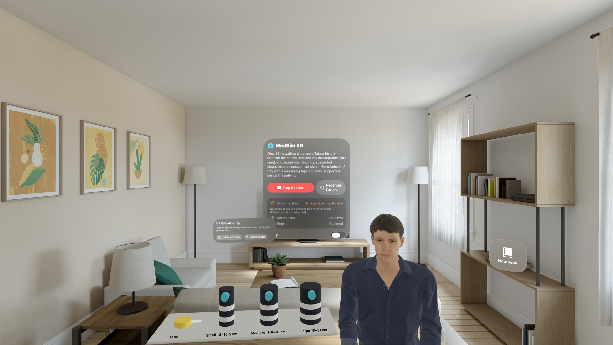
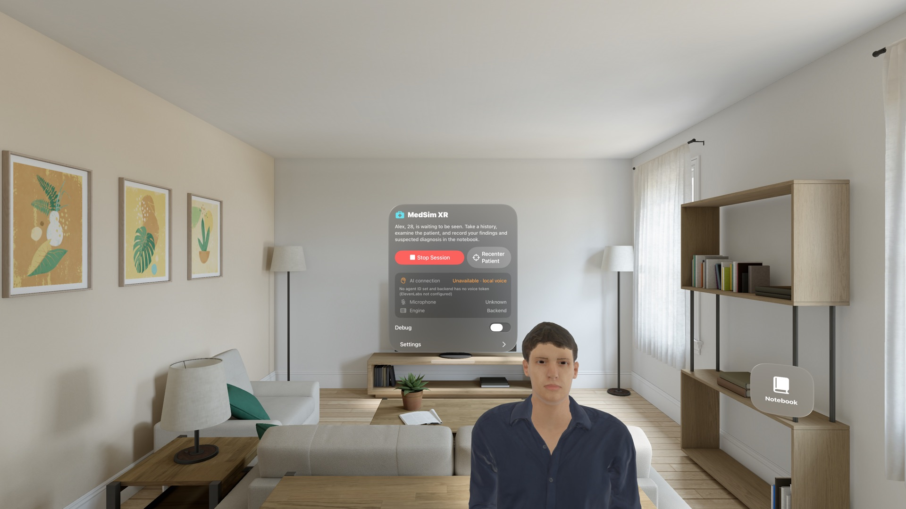
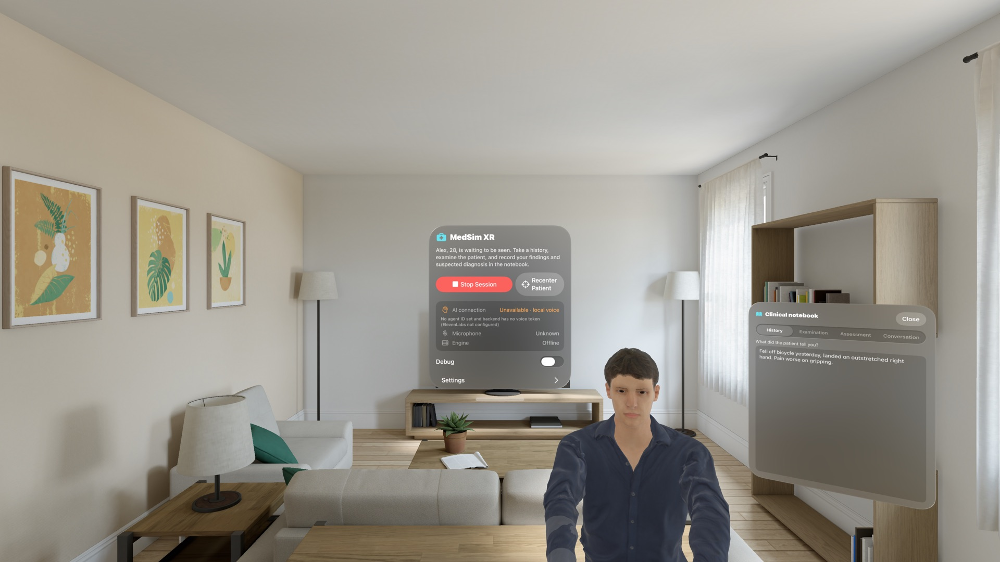
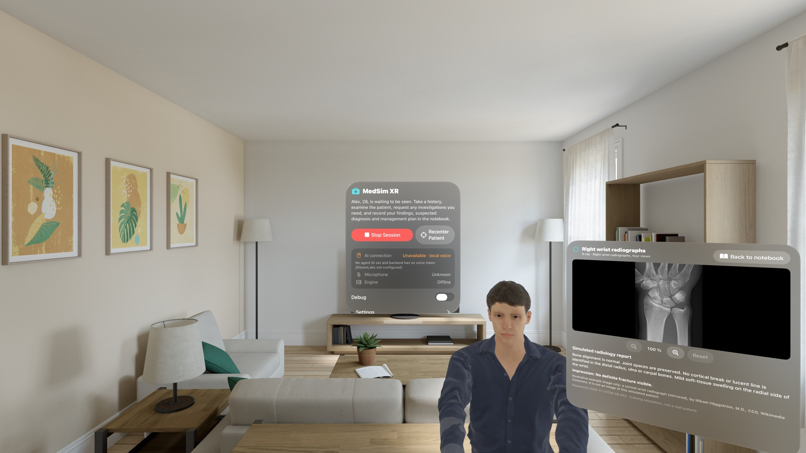
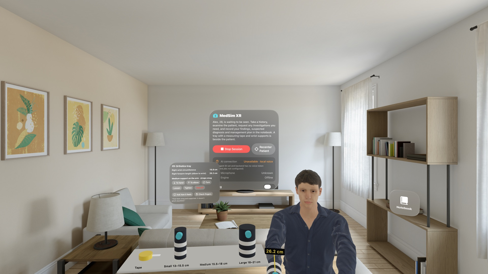
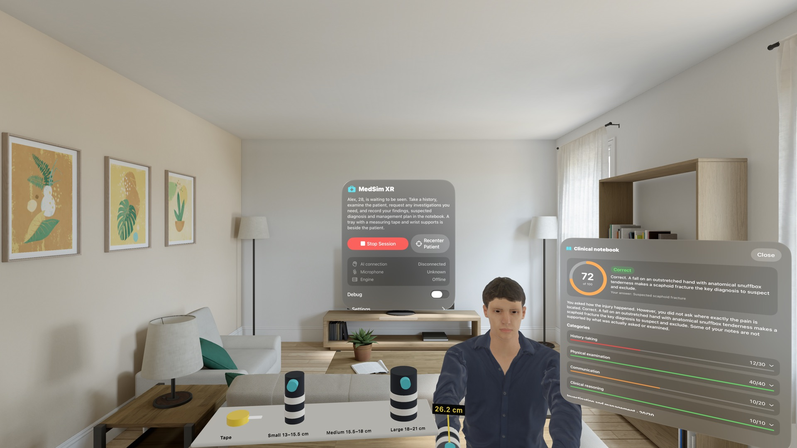

# MedSim XR — AI patient for Apple Vision Pro

A seated virtual patient in your real room. Talk to them (ElevenLabs Agents), examine
them by gaze + pinch, watch them flinch, write your findings in the notebook beside them,
commit to your own diagnosis, get structured feedback. One complete case. Nothing on screen
tells the learner what it is until they submit.

Educational simulation only. All patient data is fictional. Not a diagnostic tool.

| Seated Virtual Patient | Physical Exam & Pain Reaction |
| :---: | :---: |
|  |  |
| **Clinical Notebook** | **Spatial Radiology Viewer** |
|  |  |
| **Orthotics Lab & Sizing** | **Objective Feedback & Scoring** |
|  |  |

```
visionos/    Vision Pro app (SwiftUI + RealityKit), XcodeGen project
backend/     FastAPI clinical scenario engine + tests (runs on Windows/macOS/Linux)
scenarios/   Case definitions (JSON) — single source of truth, bundled into the app
assets/      Patient avatar build (Blender + MakeHuman CC0 assets) and licence notes
elevenlabs/  Agent prompt, dashboard setup, offline clip generator
docs/        Contracts, architecture, device setup, demo script, troubleshooting
```

## 1. Backend

macOS / Linux:
```bash
cd backend
python3 -m venv .venv && source .venv/bin/activate   # Python 3.12+
pip install -r requirements.txt
uvicorn app.main:app --host 0.0.0.0 --port 8000
```

Windows PowerShell:
```powershell
cd backend
py -3.12 -m venv .venv; .venv\Scripts\Activate.ps1
pip install -r requirements.txt
uvicorn app.main:app --host 0.0.0.0 --port 8000
```

Check: <http://localhost:8000/health>, interactive API: <http://localhost:8000/docs>.

Run the tests (from `backend/`, venv active):
```bash
python -m pytest
```

Swift offline engine check, including parity with the backend's golden fixture (macOS):
```bash
bash visionos/scripts/check_offline_engine.sh
bash visionos/scripts/check_patient_behavior.sh   # patient body state machine
```

## 2. ElevenLabs

Follow [elevenlabs/setup.md](elevenlabs/setup.md): create an agent, paste
[elevenlabs/patient_system_prompt.md](elevenlabs/patient_system_prompt.md), add
the dynamic variable `case_context`, pick the LLM and voice.

- **Public agent** (simplest): put the agent ID into `visionos/Config/Local.xcconfig`
  (`ELEVENLABS_AGENT_ID = agent_...`) or into the app's Settings panel.
- **Private agent**: `cp .env.example .env`, set `ELEVENLABS_API_KEY` and
  `ELEVENLABS_AGENT_ID`, start the backend with
  `uvicorn app.main:app --host 0.0.0.0 --port 8000 --env-file ../.env`, and leave
  the app's agent ID empty. The app fetches a short-lived token from the backend.
  No API key ever lives in the headset app.

Optional, nicer offline voice clips (replaces the macOS `say` placeholders):
```bash
ELEVENLABS_API_KEY=... ELEVENLABS_VOICE_ID=... python3 elevenlabs/generate_clips.py
```

## 3. Vision Pro app

```bash
brew install xcodegen                      # once
cd visionos
cp Config/Local.xcconfig.example Config/Local.xcconfig   # then edit, see below
xcodegen                                   # regenerate after adding/removing files
open MedSimXR.xcodeproj
```

`Config/Local.xcconfig` (gitignored):
```
MEDSIM_BACKEND_HOST = 192.168.1.50:8000    // LAN IP of the machine running the backend, no http://
ELEVENLABS_AGENT_ID = agent_xxxxxxxx       // empty for private agents
DEVELOPMENT_TEAM = ABCDE12345              // your Apple team ID
```

Both values can also be changed at runtime: Session page → Settings (applies on the next Start).
Find the backend machine's IP with `ipconfig getifaddr en0` (macOS) or `ipconfig` (Windows);
headset and backend must be on the same Wi-Fi.

Run on the headset: select the Vision Pro as destination in Xcode and press Run.
Full device steps (developer mode, pairing, permissions): [docs/vision-pro-setup.md](docs/vision-pro-setup.md).
Requires visionOS 26+.

Command-line compile check (no signing):
```bash
cd visionos && xcodebuild -quiet -project MedSimXR.xcodeproj -scheme MedSimXR \
  -destination 'generic/platform=visionOS' CODE_SIGNING_ALLOWED=NO build
```

## 4. Using it

- **Scenario dashboard** (the control panel while no session runs): cards for every case in
  `scenarios/` (icon, spoiler-free summary, skills), a **Surprise me** card that draws a random
  case, mood and patient and keeps them hidden until Start, and a **Customize** section with the
  patient's **mood** (calm, nervous, angry) and **appearance** (male, female) for the selected
  case. A case that allows only one value shows it locked. The last choice is remembered. Mood and
  appearance change how the patient talks and looks, never the findings or the scoring.
  Launch arguments `-scenario <case_id> -mood <m> -avatar <a>` preselect them.
- **Continuous journey case** (`road_trauma_journey_001`, "Road accident: Jordan, 34"): a cyclist
  knocked off by a car. You work with an AI ambulance crew at the roadside, travel with the patient
  in the ambulance, and hand over to an AI emergency team at the hospital. The control panel and the
  notebook's **Team** tab show where you are, who is there, a button per thing the team can do there
  (observations, bleeding control, splint, pain relief, cannula, pre-alert, antibiotics, …) and
  **Move on** to the next place. You can also ask the team out loud (the voice agent routes it).
  Every team line and result comes from the case engine; the feedback is scored per place.
  Each place is drawn around you (the street with the crashed car, the bicycle and the ambulance;
  then the inside of the ambulance; then a resus bay), with the patient on a response case, the
  stretcher or the trolley instead of the clinic stool. Turn the Digital Crown to blend in your room.
- **Control panel during a session**: Stop, Recenter, status, and a **Debug** toggle (examination and
  scripted-question buttons, last finding). Nothing else.
- **Notebook** (floats beside the patient, pinch to open): History, Examination, Assessment,
  Conversation. Every note has a **Dictate** button: tap it, speak, tap **Stop dictating** and
  the words are added to that note. Transcription uses ElevenLabs Scribe through the backend
  (`POST /elevenlabs/transcribe`, needs only `ELEVENLABS_API_KEY`); without it the app uses
  Apple's speech recognition on the same recording. Typing and the keyboard's own dictation key
  still work. While the notebook is open the patient's microphone is muted, so dictated notes
  are not heard as speech to the patient.
- **Diagnosis**: written by the learner under Assessment, no suggestions offered. Feedback
  appears in the notebook and compares the notes with what was actually asked and examined;
  writing down an examination that never happened earns nothing and is flagged.
- **Patient model**: `visionos/MedSimXR/Resources/Patient.usdz` (male) and `Patient_female.usdz`,
  each with a `.json` sidecar of the same name, CC0, rebuilt with
  `assets/patient/build.sh` ([details](assets/patient/README.md)). A case can force a model with
  `catalog.avatar_model`. A missing model falls back to `Patient`; launch argument
  `-proceduralAvatar` falls back to the primitive body.
- **Optional voice per appearance**: Settings > ElevenLabs voice ID (male / female). Needs the
  voice override enabled on the agent ([elevenlabs/setup.md](elevenlabs/setup.md)).
- **Dashboard screenshots without a headset**:
  `visionos/scripts/simulator_smoke_test.sh --mock-voice --out DIR --app-args "-dashboardOnly -mood nervous -avatar female"`.

## 5. Demo

[docs/demo-script.md](docs/demo-script.md) — 90 seconds. Everything except the live
conversation also works with no network at all (Debug mode has buttons for every
examination zone and scripted question).

## Status

Launched and exercised in the visionOS 27.2 simulator: app start, mixed immersive space, the
realistic seated patient on a stool, all three examinations with correct findings, joint-driven
flinch and arm withdrawal, zone flash, local clips started, notebook notes, learner-written
diagnosis, feedback with notes-versus-record, reset, and backend killed mid-session with the
session continuing offline. Details, evidence and the per-feature status table:
[docs/simulator-test-report.md](docs/simulator-test-report.md).

Re-run it:
```bash
visionos/scripts/simulator_smoke_test.sh --kill-backend   # needs: xcodebuild -downloadPlatform visionOS
```

**Not verified:**

- Gaze + pinch on the avatar, typing, scrolling: nobody has operated the app by hand yet.
- Audio was started, never listened to.
- Live ElevenLabs conversation: no credentials on the development machine. `-mockVoice` is a scripted stand-in.
- Anything that needs the headset: head-relative placement, passthrough, microphone, hand tracking.

First session with the headset: [docs/tomorrow-headset-checklist.md](docs/tomorrow-headset-checklist.md).

Known limits:

- Transcript scoring is whole-word keyword matching (labelled "heuristic" in the feedback). It
  cannot judge empathy or meaning, only whether certain phrases were said.
- Without live voice, history and communication points come only from the scripted Debug questions.
- The avatar is a static seated pose with a few animated joints: no lip sync, no facial expression, fingers do not move.
- Notes are compared by keyword, like the transcript: it detects that something was written down, not whether it is right.
- Offline speech uses macOS `say` placeholder clips until `generate_clips.py` is run.
- English only, sessions in memory (a backend restart drops them; the app then continues offline).

## MedSim Studio and Live Director

Instructors configure a scenario from a supported case (setting, difficulty, equipment,
companions), publish it under a launch code, start it in the app, trigger predefined events
during the session, and get a debrief that reads the score against what the scenario offered.
Scenarios never hold or change clinical facts. Overview, demo path and what was verified:
[docs/medsim-studio.md](docs/medsim-studio.md); API: [docs/studio-api.md](docs/studio-api.md).

```bash
cd studio && npm install && npm run build      # then open http://localhost:8000/app/
visionos/scripts/scenario_smoke_test.sh --variant walkin   # scenario + director in the simulator
visionos/scripts/scenario_smoke_test.sh --variant studio   # the Studio window inside the headset
```

Seeded launch codes: `LKGLZX` (quiet clinic, full kit, guided) and `5344E7` (busy walk-in,
limited kit, challenging). Both are experimental, not clinician-reviewed.

The app opens on MedSim Studio, which browses My scenarios, Downloaded and the
Marketplace, launches a scenario without typing its code, and shows debriefs. Authoring and
the Live Director stay in the web Studio, on the instructor's screen.

## Orthotics lab

Spatial measuring and wrist-support fitting on the patient's right arm (`Reality/OrthoticsLab.swift`, `Reality/SpatialMeasurementTool.swift`, `backend/app/fitting.py`). An educational fitting simulation, not a validated medical-device sizing system. See `docs/demo-script.md` and `docs/api-contract.md`.
